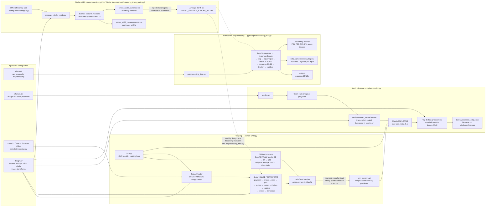

# Handwriting project map

This chart follows the files and data paths implemented in the repository. Mermaid diagrams render in GitHub and in Markdown previews that support Mermaid.

## End-to-end file and data flow

The dotted training-to-weights edge indicates the intended relationship, not an active save operation: `CNN.py` currently has its `torch.save(...)` call commented out. The checked-in `cnn_mnist_1.pt` is loaded by `predict.py`.

## Repository inventory

| File or folder | Role |
|---|---|
| `CNN.py` | Defines the convolutional network, selects and transforms training data through `design.py`, and runs training/testing when executed directly. |
| `design.py` | Central runtime configuration: dataset selection and paths, class-index-to-character mapping, preprocessing transforms, and number of output classes. It reuses helper functions from `preprocessing_final.py`. |
| `preprocessing_final.py` | Standalone image preprocessing pipeline. Running it directly reads `charset/`, writes accepted PNGs and a processing log to `output/`, and saves intermediate checkpoint images to `secondary results/`. |
| `predict.py` | Reads supported image files from `charset_2/`, applies preprocessing, loads the CNN weights, and writes top-three predictions to `batch_prediction_output.csv`. |
| `cnn_mnist_1.pt` | Saved model state dictionary loaded for prediction. |
| `batch_prediction_output.csv` | Batch prediction results: source filename and three predicted characters with confidence percentages. |
| `charset/` | Raw image inputs for the standalone preprocessing script. |
| `charset_2/` | Image inputs enumerated by the batch prediction script. |
| `output/` | Processed character PNGs, a `rejected/` subfolder created by the script, and `preprocessing_log.csv` with accepted/rejected status and failure reasons. Failed source images are not moved into `rejected/`. |
| `secondary results/` | Per-image intermediate images produced by `preprocessing_final.py`; suffixes identify processing checkpoints. |
| `Stroke Measurement/measure_stroke_width.py` | Selects a repeatable sample of EMNIST `O` images and measures their horizontal stroke widths. |
| `Stroke Measurement/stroke_width_measurements.csv` | Per-image stroke-width measurements. |
| `Stroke Measurement/stroke_width_summary.txt` | Measurement settings and aggregate statistics, including the average used as the thickening target. |
| `PROJECT_MAP.md` | This overview of the repository files and processing flows. |

## Important distinction between image paths

- The standalone preprocessing command is `python preprocessing_final.py`; its default path is `charset/` → `output/`.
- Training uses the dataset configured in `design.py` and the transform assembled there. It does not train from `output/` by default.
- Prediction reads from `charset_2/` and writes `batch_prediction_output.csv`; it does not read the standalone preprocessing outputs.
- Both the standalone pipeline and the training/prediction transform use the same helper routines from `preprocessing_final.py`, but the standalone script writes checkpoint images and logs while the transform is applied in memory.
